# DrUIKit

[English](README.md) | **한국어**

언리얼 엔진 5.9용(5.8 호환) **스타일 중립 UI 부품** 플러그인이다. 엔진·CommonUI 위젯을 상속해 확장하고, 상속으로 안 되는 것은 UserWidget 안에서 조합한다. 모양은 테마 토큰으로만 칠하고, 실제 디자인은 스타일(`UISample/<스타일>`)이 입힌다. 스타일은 `tokens.json`을 가진 플러그인이고 코어가 시작할 때 읽는다. 샘플 스타일은 글래스·플랫·네오 브루탈리즘·뉴모피즘·레트로 터미널에, 게임에서 흔한 판타지 RPG·양피지·SF 홀로그램·사이버펑크 네온·캐주얼 모바일·다크 판타지를 더한 열한 가지다.

> 상태: 0.1.0(1차·2차 부품, UI 흐름·화면 층). 기획·구현 현황: `Docs/PLAN.md`.

## 구성

| 위치 | 역할 |
| --- | --- |
| `unreal/DrUIKit` | 코어 플러그인(모듈 `DrUIKit`, 의존: UMG·CommonUI) |
| `Host/DrUIKitHost.uproject` | 단독 빌드·테스트 호스트(코드 모듈 없음) |
| `UISample/Glass` | 리퀴드 글래스 스타일(플러그인 `DrUIGlass`: 토큰, Pretendard 글꼴, 바탕, 갤러리 테스트 레벨 `L_DrUIGallery`) |
| `UISample/Flat`·`Brutal`·`Neu`·`Retro` | 플랫·머티리얼, 네오 브루탈리즘, 뉴모피즘, 레트로 터미널 스타일(플러그인 `DrUIFlat`·`DrUIBrutal`·`DrUINeu`·`DrUIRetro`: 코드 없이 토큰만) |
| `UISample/Fantasy`·`Parchment`·`SciFi`·`Cyber`·`Casual`·`DarkFantasy` | 게임 UI 스타일: 판타지 RPG(풍경·선술집 바탕 그림, 양피지·가죽 패널에 청동·금 장식 테두리, 명조), 양피지(서재 책상 바탕, 찢긴 가장자리 종이 패널과 선 없는 종이 상자, 명조 세피아 잉크·봉랍), SF 홀로그램(반투명·청록 발광·각진 모서리), 사이버펑크 네온, 캐주얼 모바일(두꺼운 외곽선·둥근 모서리·단단한 아래 그림자), 다크 판타지(성당·황야 바탕 그림, 거의 검은 패널에 옅은 금빛 꺾쇠). 판타지·양피지·다크 판타지는 토큰 + `Images/`, 나머지는 토큰만 |
| `Tools/verify.ps1` | 호스트 빌드 + `Automation RunTests DrUIKit+DrUIGlass` |

## 지금 있는 것

이름: 부품은 `UDr<부품>`(`UDrButton`), 부품이 아닌 기반 시스템은 `UDrUI<…>`(`UDrUITheme`).

| 영역 | 클래스 |
| --- | --- |
| 테마 | `UDrUITheme`(토큰 묶음 데이터 에셋, 회색조 기본 테마), `UDrUIThemeSubsystem`(현재 테마·전환·표면 품질·표면 투명도·움직임 줄이기), `DrUIStyle`(스타일 로더: 스타일 플러그인을 찾아 `tokens.json`·`style.json`을 읽음), `UDrUIKitSettings` |
| 상태·움직임 | `EDrUIState`·`DrUIState::Resolve`(9상태 우선순위), `DrUIMotion`(이즈 인·아웃 cubic-bezier, 순차 등장 `PlayStagger`), `FDrUISpring` |
| 기초 부품 | `UDrText`(UCommonTextBlock), `UDrIcon`(UImage), `UDrGlyph`(선으로 그리는 표시: 체크·점·더하기·닫기·화살표·느낌표), `UDrSurface`(UBorder + 뒤 흐림, 채움 토큰이 비면 투명, 그림자(여러 겹·흐림 없는 어긋난 그림자)·윗면 반사광은 토큰을 정한 표면만 `SetElevation`, 테두리 두께는 테마를 따름) |
| 누르는 부품 | `UDrButtonBase`(공통 상태 판정 틀, 추상), `UDrButton`(9상태·변형 4종) |
| 선택 부품 | `UDrToggleBase`(켜고 끄는 부품 공통 틀, 추상), `UDrCheckBox`(체크 그리기), `UDrRadio`(+ `UCommonButtonGroupBase`로 하나만 선택), `UDrSwitch`(스프링 손잡이), `UDrTabList`·`UDrTabButton`(UCommonTabListWidgetBase, 알약·밑줄 인디케이터가 미끄러짐), `UDrSegmentedControl`(값 하나 고르기), `UDrSlider`(USlider + 채움 트랙·눈금 점·값 말풍선) |
| 상태 표시 | `UDrBadge`(숫자·99+·점, 색 6종), `UDrProgressBar`(UProgressBar, 둥근 트랙·채움 움직임·끝없는 진행), `UDrProgressRing`(원형 진행률, 스프링·끝없는 회전), `UDrSkeleton`(불러오는 중 자리 표시), `UDrSpinner`(UCircularThrobber, 토큰 색) |
| 알림 | `UDrNoticeBase`(떴다 사라지는 부품 공통 틀, 추상), `UDrToast`(유리 알약 + 색·모양 표시 4종), `UDrToastStack`(토스트 쌓기, 최대 개수 넘으면 오래된 것부터 물러남), `UDrSnackbar`(진한 알약 + 행동 버튼, 한 번에 하나·차례 줄, 호버 중 시간 멈춤) |
| 입력 | `UDrTextField`(UEditableText + 라벨·안내·글자 수·오류), `UDrDropdown`·`UDrDropdownMenu`·`UDrDropdownItem`(UMenuAnchor 목록, 고른 항목부터 포커스), `UDrHorizontalSelector`(◀ 값 ▶, 패드 좌우·감쌈/멈춤) |
| 게임패드 | `DrUIInput`(확인·뒤로는 엔진 내비게이션 설정을 따름, Xbox·PlayStation·Nintendo 버튼 이름, 덮개 층, 포커스 기억, 전역 처리기: 오른쪽 스틱 스크롤·LB/RB·LT/RT 탭 넘김·버튼 단축키·아무 키 대기), `UDrKeyGlyph`(에셋 없이 그리는 버튼 모양: 얼굴 버튼(✕○□△ 포함)·숄더·트리거·스틱·D패드·보기/메뉴, 키캡, 마우스), `UDrActionBar`(상태 글 + 포커스 부품의 행동 + 화면 공통 안내), `UDrOptionRow`(설정 한 줄: 좌우는 줄 안 조작 부품, 위아래는 이웃 줄), `UDrPressAnyKey`, `UDrItemSlot`·`UDrItemGrid`(인벤토리 칸: 희귀도·장착·NEW·수량, 줄 끝 넘김), `UDrStatCompare`(장착 대비 ▲▼), `DrUIFeedback`(UI 소리·짧은 진동) |
| 게임용 | `UDrHoldButton`(길게 눌러 실행, CommonUI 길게 누르기 + 차오르는 채움·되감기), `UDrRadialMenu`(파이 메뉴: 마우스 방향·패드 스틱·키보드, 강조가 스프링으로 미끄러짐), `UDrCooldown`(아이콘 위 시계 방향 막·남은 시간·반짝임), `UDrFeed`·`UDrFeedEntry`(획득 로그, 같은 글은 ×N으로 합침) |
| UI 흐름 | `UDrUIFlowSubsystem`(로컬 플레이어 서브시스템: 화면 층 자동 생성, 타이틀·HUD·일시정지·설정·뒤로·입력 모드·확인 대화상자·알림), `UDrUIRootLayout`(게임·메뉴·모달·알림 층), `UDrUIMenuWidget`·`UDrUIHUDWidget`(메뉴·HUD 기반), `UDrConfirmDialog`(모달 확인 창). 설정은 `UDrUIKitSettings`의 '흐름'·'입력'. DrFramework 0.2.0 UI를 옮긴 것 |
| 2차·확장 | `UDrScrollBox`(얇은 막대·가장자리 그늘), `UDrCountUp`(세어 올라가는 숫자), `UDrAnimatedSwitcher`(페이드·밀기·확대, 움직임 줄이기면 바로), `UDrExpandableArea`·`UDrExpanderHeader`(높이 스프링), `UDrTextArea`(여러 줄 입력), `UDrMorphButton`(로딩이면 원으로 줄고 체크 뒤 펴짐), `UDrQuantityStepper`·`UDrIconButton`(− 값 +, 길게 누르면 가속 반복), `UDrChip`(필터·선택·입력 칩) |
| 2차·탐색 | `UDrSidebar`·`UDrSidebarItem`(레일 ↔ 펼침, 유리 렌즈), `UDrDock`·`UDrDockItem`(가리키면 확대), `UDrBottomTabBar`·`UDrBottomTabButton`(표시+이름 탭), `UDrBanner`(화면 안 알림 줄), `UDrBottomSheet`(아래에서 올라오는 판, 끌어 닫기), `UDrCoachMark`·`UDrCoachScrim`(구멍 뚫린 막 + 단계 말풍선), `UDrPopover`·`UDrPopoverPanel`(누른 자리 옆 유리 판) |
| 2차·표현 | `UDrStepIndicator`(단계 표시), `UDrCompletion`(체크 그리기 완료 표시), `UDrEmptyState`(빈 화면: 이유 + 다음 행동), `UDrTextReveal`(글자 등장: 타이핑·스크램블·올라오기), `UDrSparkline`·`UDrDonut`·`UDrStatCard`(데이터 표시) |
| 탐색·표시 | `UDrTooltip`(엔진 툴팁 창에 넣는 유리 말풍선, 제목+설명, 나타날 때 내려오며 밝아짐, `Attach`), `UDrListRow`(목록 행: 호버 렌즈·선택·포커스. 짧은 목록은 버튼 묶음, 긴 목록은 UCommonListView 항목 — 에디터에서는 이 클래스를 부모로 한 위젯 블루프린트가 필요), `UDrListItem`(항목 데이터), `UDrPageIndicator`(페이지 점, 지금 점이 알약으로 늘어나 미끄러짐), `UDrButtonPrompt`(키캡 칩 + 행동 이름, 키보드↔패드 자동 전환, 길게 누르기 진행) |

## 게임패드

모든 부품은 패드나 키보드만으로 조작할 수 있다.

- 포커스 링은 패드·키보드로 옮긴 포커스에만 보이고, 마우스로 누른 뒤에는 남지 않는다. 덮개(대화상자·팝오버·시트·드롭다운·코치마크)는 연 곳을 기억했다가 닫을 때 포커스를 돌려주고, 메뉴는 돌아오면 마지막 항목으로 간다.
- 확인·뒤로는 엔진 내비게이션 설정을 따르므로, 두 버튼을 바꿔 쓰는 플랫폼에도 맞는다. 슬라이더는 잠그지 않고 D패드로 바로 조절하고, 스크롤 상자는 포커스를 따라 굴러가며 오른쪽 스틱으로도 굴린다. 탭 목록은 `Paging`을 Bumpers(LB/RB)나 Triggers(LT/RT)로 정하면 그 키로 넘기고 양 끝에 키를 보이며, 탭에서 아래로 가면 내용으로 들어간다. 부품은 방향마다 다음 대상을 직접 정할 수 있고(`NavTargets`, `DrUIInput::ChainVertical`), D패드와 스틱 모두에 통한다. 덮개가 열려 있으면 아래 층은 방향 이동에 반응하지 않는다.
- **인라인 버튼 프롬프트:** 버튼에 `SetShortcut(키보드 키, 패드 키)`를 주면 버튼 안에 키 모양이 붙는다. 화면 어디서든 그 키로 눌리고, 덮개가 열려 있으면 그 덮개 안 버튼만 반응한다.
- **키 모양:** 버튼 프롬프트와 행동 안내 바는 Xbox·PlayStation·Nintendo 패드 모양으로 그린다. 자동이면 연결된 패드를 따르고, `Both`면 패드 키와 키보드 키를 함께 보인다. `Glyphs/glyphs.json`(Xbox·PlayStation·Nintendo·키보드 세트별 키 이름 → PNG)을 가진 플러그인이 있으면 벡터 대신 그 이미지를 쓴다(실행 중에 읽음, 에셋 없음, `DrUIGlyphImages`). 콘솔 출시용은 각 플랫폼 개발자 포털의 공식 이미지로 이런 세트를 만들어 비공개 플러그인으로 꽂고, 공개 샘플 `UISample/Prompts/DrUIPromptsKenney`는 Kenney Input Prompts(CC0, 플랫폼 공식 이미지 아님)를 쓴다. 흰색 이미지는 테마 색을 입히고(`"tint"`), `<표기>_brand` 세트는 고유색 얼굴 버튼, 세트에 없는 키(여기선 D패드)는 벡터로 남는다. 스타일 플러그인처럼 패키지에는 `Glyphs/` 폴더를 함께 넣어야 한다.
- **마우스와 패드:** `DrUIInput::GetLastInputKind()`로 마우스·키보드·패드를 구분한다. 마우스는 뎁스를 거치지 않고 어디든 바로 누르고, 패드·키보드는 포커스를 따라간다. 패드로 다시 바꾸면 마우스로 보던 자리(또는 마지막 패드 자리)에서 이어 간다.
- **접근성·피드백:** 글자 크기 배율(`SetTextScale`), UI 소리(프로젝트 설정에서 지정), 짧은 진동. 셋 다 끌 수 있다.

**콘솔 게임 메뉴 샘플**(`UDrGlassConsoleMenu`, 갤러리 '게임패드' 페이지에서 열거나 View·M)은 전형적인 패드 메뉴 배치다.

- 위: 메인 탭(LB/RB)과 서브 탭(LT/RT)
- 가운데 세 칸: 1뎁스 목록, 2뎁스 목록, 정보 패널(능력치 비교 포함)
- 아래: 쓸 수 있는 행동이 보이는 상태 표시줄
- 패드: 목록은 위아래가 이어지고 포커스가 메뉴 밖으로 나가지 않는다. 오른쪽·A는 2뎁스(전에 있던 줄)로, 왼쪽·B는 1뎁스로, 탭을 넘기면 1뎁스로 간다. 2뎁스에서 A는 장착, X는 버리기.
- '설정' 탭의 2뎁스는 옵션 줄(선택기·슬라이더·세그먼트·스위치·체크박스·라디오·수량·드롭다운·텍스트 입력·길게 누르기·대화상자 버튼)이라 좌우 조작 부품을 모두 시험할 수 있다.
- 마우스: 어느 뎁스든 바로 누르고, 올리면 정보를 미리 보며, 오른쪽 클릭·Esc로 닫는다.

| 콘솔 게임 메뉴 | 게임패드 페이지(PlayStation 표기) |
| --- | --- |
| 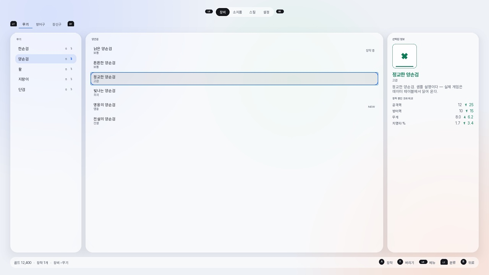 | 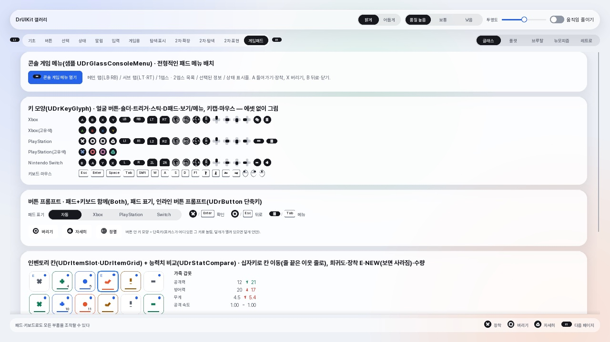 |

## 스타일

스타일은 `Tokens/tokens.json`(디자인 토큰, 밝게·어둡게)과 `Tokens/style.json`(id·이름·글꼴·투명도 설정을 따를 채움 토큰·기본 테두리 두께)을 가진 켜진 플러그인이다. 코어가 시작할 때 모두 읽고, 테마 id는 `<스타일>-light`·`<스타일>-dark`다. 글꼴은 TTF 경로(`{plugin}`, `{plugin:이름}`, `{engine}`)로 지정하고, 한글이 없는 글꼴은 `hangul` 서체로 한국어 글자만 대신 그린다. `style.json`의 `images`로 색 토큰 대신 그림을 쓸 수 있다: `ground`는 화면 바탕(`fit: cover`, 비율 유지·가득 채움), 그 밖의 토큰은 그 토큰으로 채우는 표면을 9분할(`margin`은 이미지 픽셀, `scale`은 화면 배율, 얇은 표면이면 테두리를 줄여 그림)로 칠하고, 내용은 `padding`(안전 여백, 없으면 `margin`) 안쪽에 둔다. 경로의 `{mode}`는 `light`·`dark`로 바뀌고, PNG·JPG를 처음 쓸 때 텍스처로 만든다(에셋 없음). 그림으로 칠하는 표면은 뒤 흐림·반사광을 그리지 않는다. 패키지에 넣으려면 `DrUIGlass`처럼 `Tokens/`(와 글꼴·`Images/`)를 `RuntimeDependencies`로 함께 넣는다.

| 플랫(밝게) | 네오 브루탈리즘(밝게) |
| --- | --- |
| 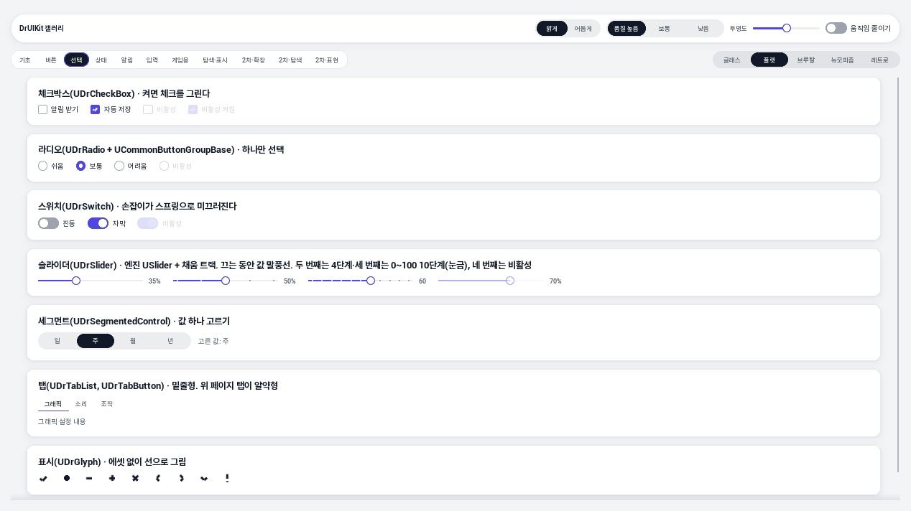 | 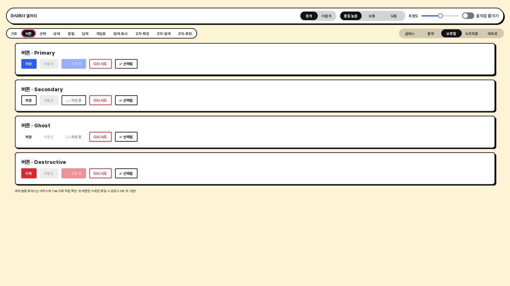 |
| 뉴모피즘(밝게) | 레트로 터미널(어둡게) |
| 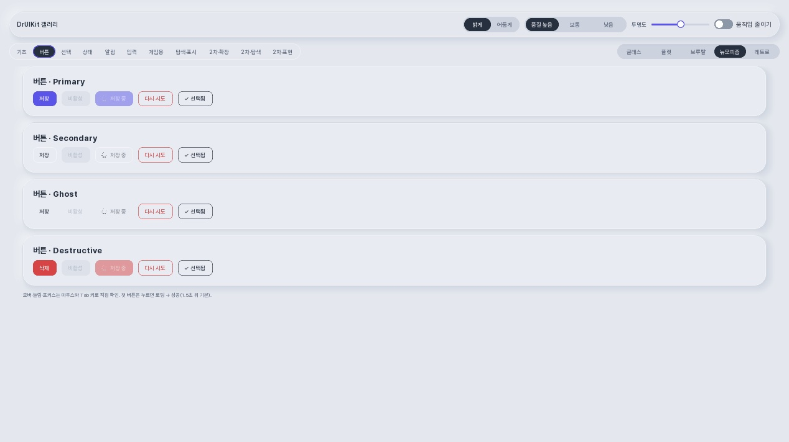 | 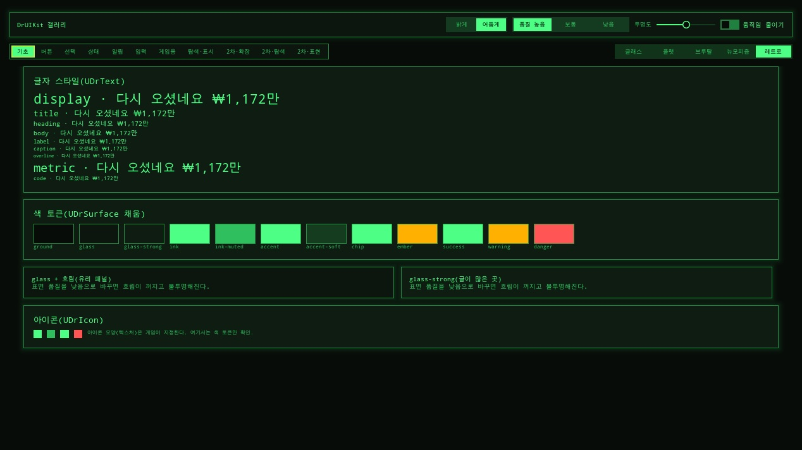 |
| 판타지 RPG(어둡게) | SF 홀로그램(어둡게) |
| 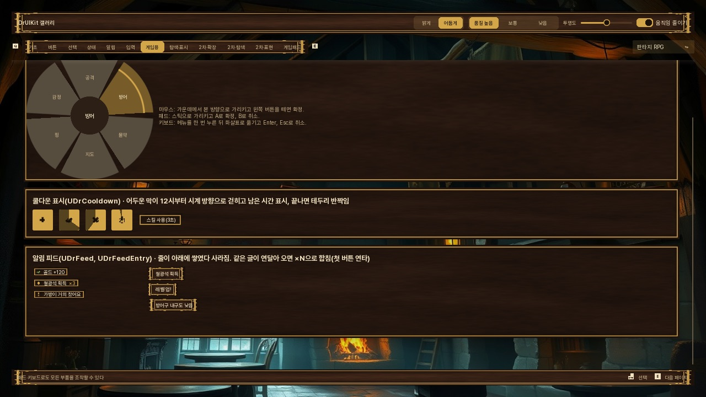 | 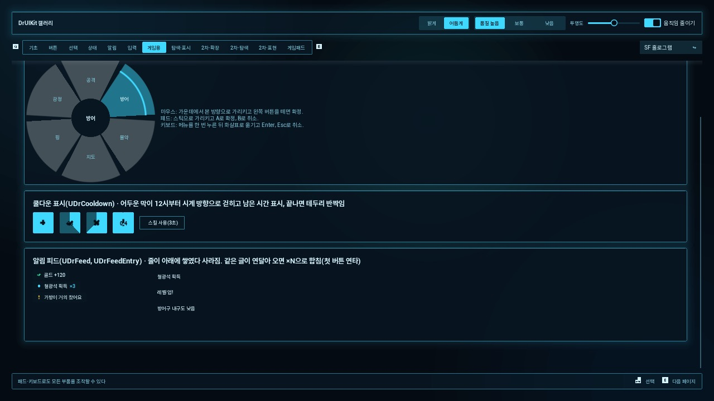 |
| 사이버펑크 네온(어둡게) | 캐주얼 모바일(밝게) |
| 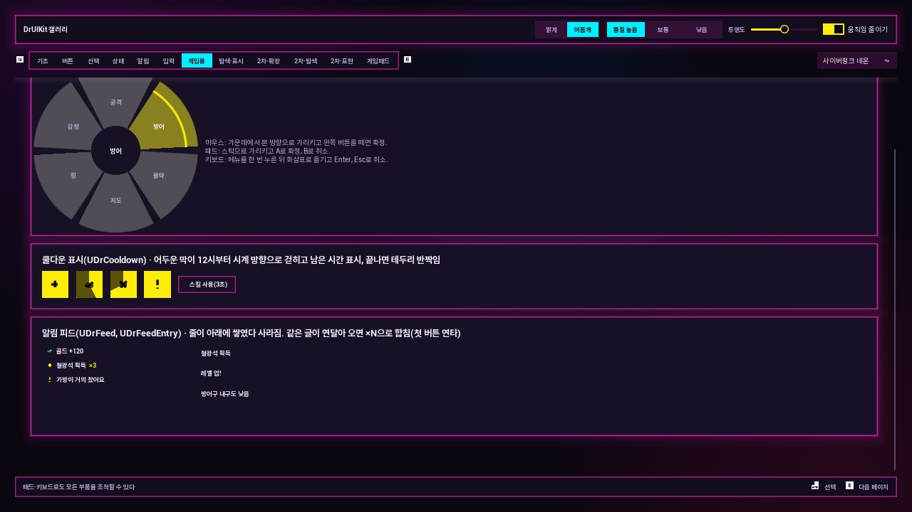 | 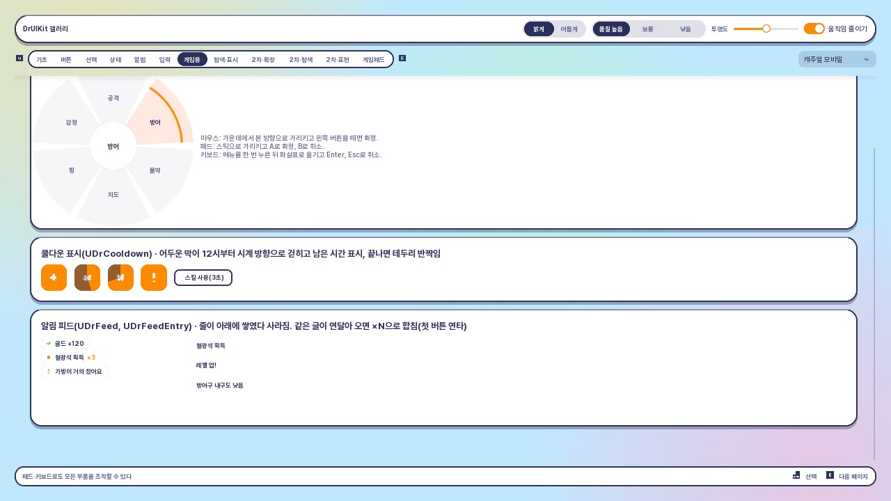 |
| 다크 판타지(어둡게) | 양피지(밝게) |
| 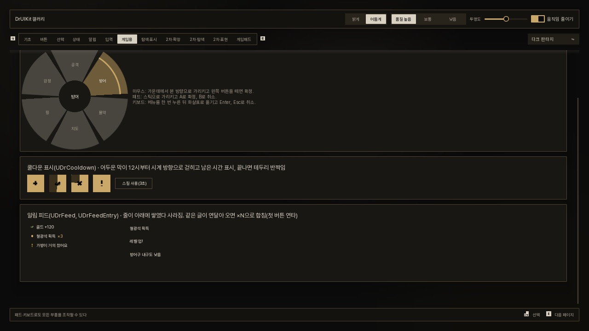 | 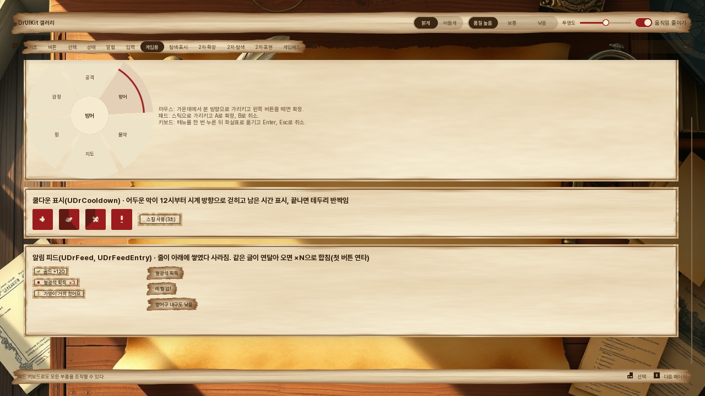 |

## 갤러리

| 버튼(밝게) | 선택 부품(어둡게) |
| --- | --- |
| 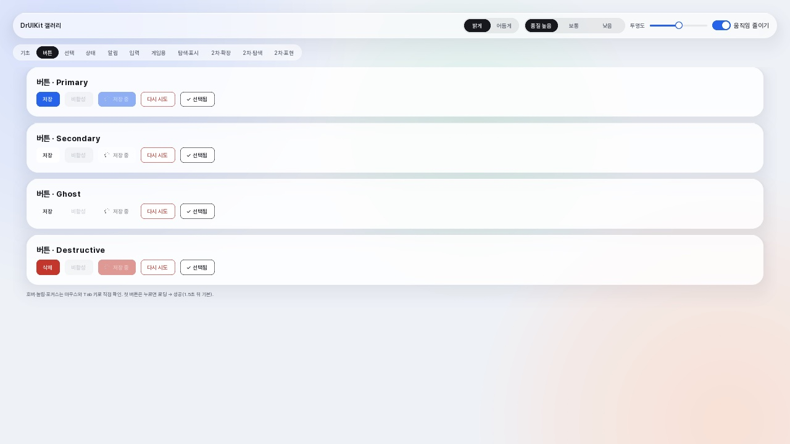 | 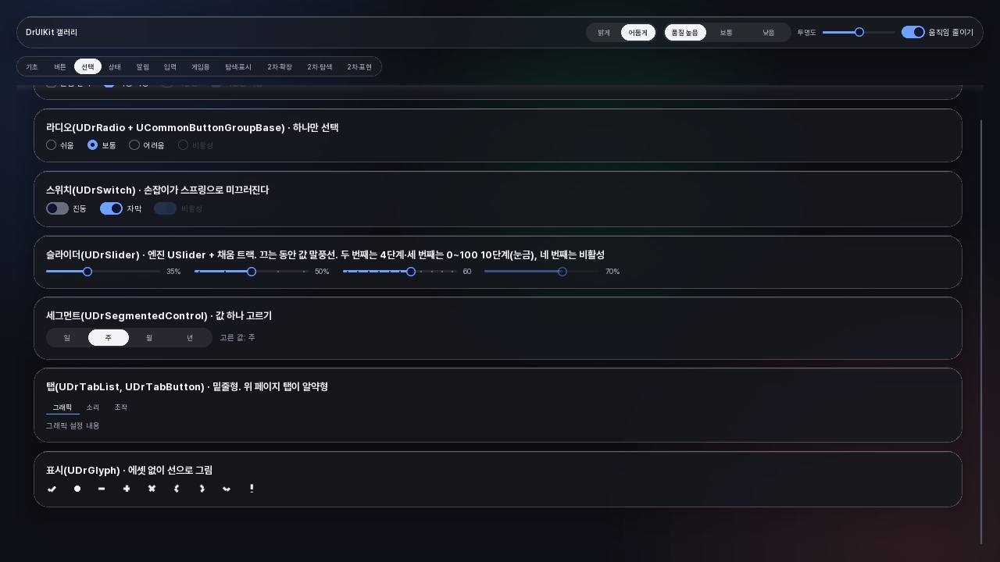 |
| 게임용(파이 메뉴·쿨다운·피드) | 탐색·표시(페이지 점·버튼 프롬프트) |
| 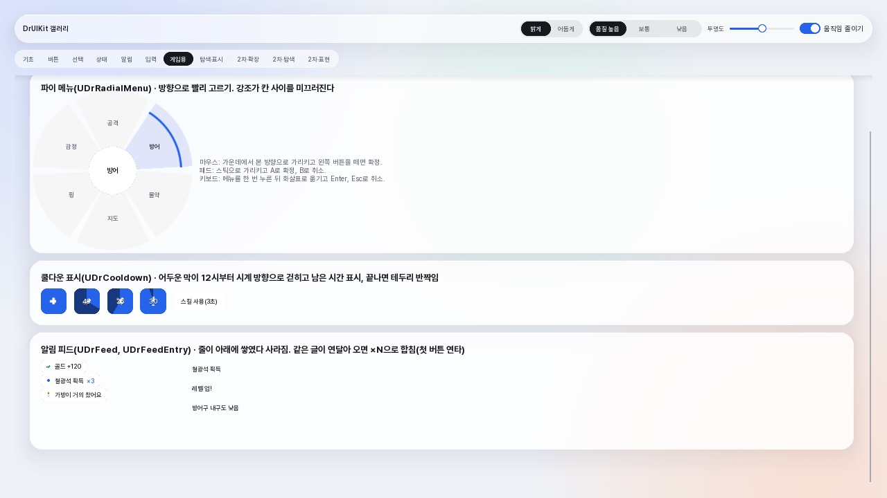 | 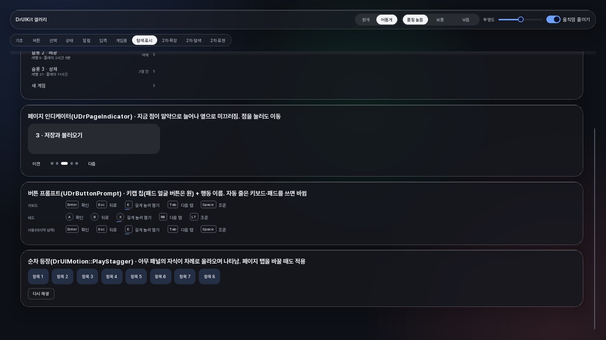 |
| 확인 대화상자(모달 층) | 표현(빈 화면·글자 등장·데이터) |
| 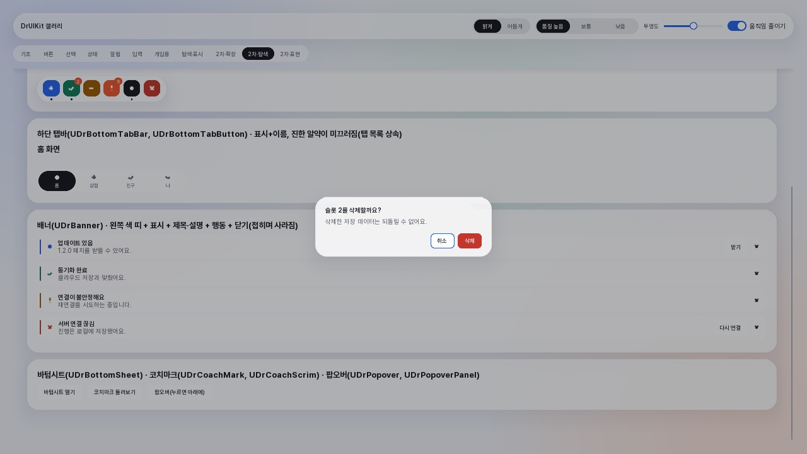 | 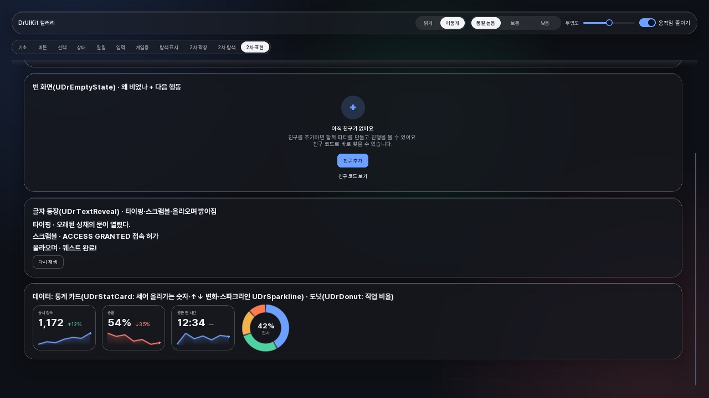 |

`UISample/Glass`의 `L_DrUIGallery`(호스트 기본 맵)를 열면 모든 부품이 탭별 페이지에 놓여 있고, 탭 줄 오른쪽에서 스타일을 바꾼다. 새 부품은 같은 작업에서 갤러리 페이지와 `UDrGlassGallery::CoveredClasses()`에 넣는다(빠뜨리면 `DrUIGlass.Gallery.CoversAllKitWidgets` 실패). `-game -DrUIGalleryCapture -RenderOffscreen`으로 실행하면 스타일 × 밝게·어둡게 × 페이지마다 `Saved/Screenshots`에 찍고 끝난다(`-DrUIGalleryStyles=glass,flat`으로 스타일을 줄일 수 있다). `-DrUIGamepadTour`로 실행하면 합성 패드 입력으로 게임패드 페이지와 콘솔 게임 메뉴를 돌며 단계마다 찍는다(`DrUITour_*.png`).

## 검증

```powershell
.\Tools\verify.ps1      # 기본 엔진: C:\Program Files\Epic Games\UE_5.9, 없으면 UE_5.8
```

2026-11-19 UE 5.9.0과 5.8.4에서 확인: 호스트 빌드, `DrUIKit.*` 31/31, 두 엔진 모두 `RunUAT BuildPlugin` 단독 빌드 경고·오류 0.

## 라이선스

MIT
