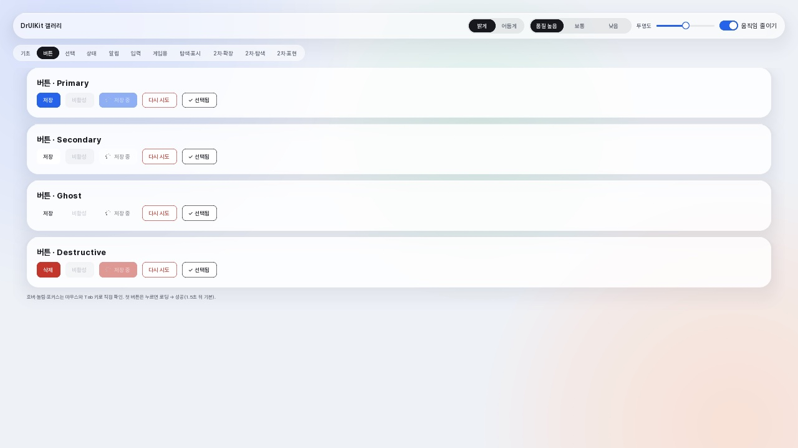
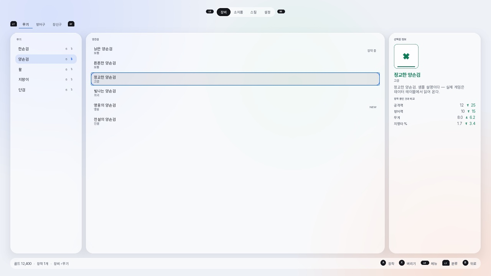
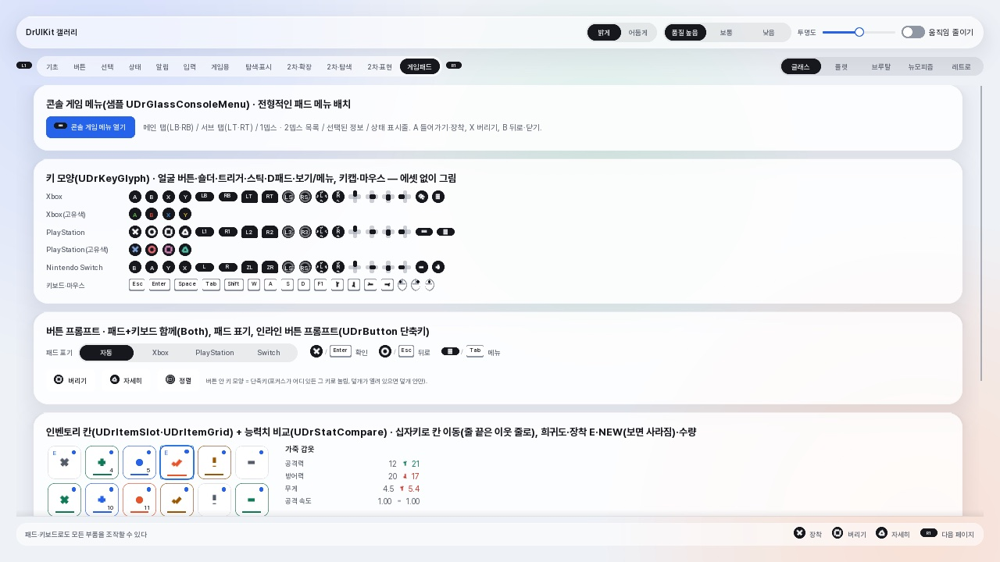
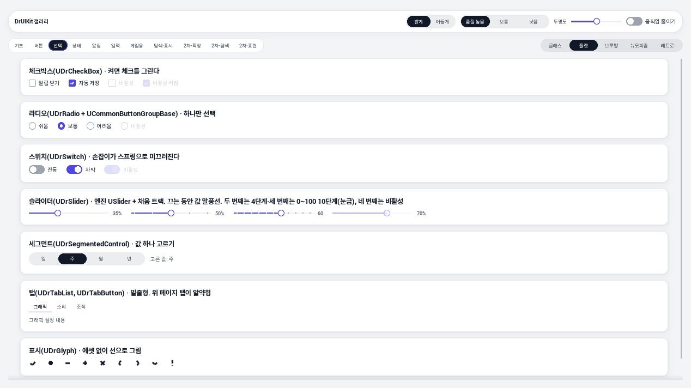
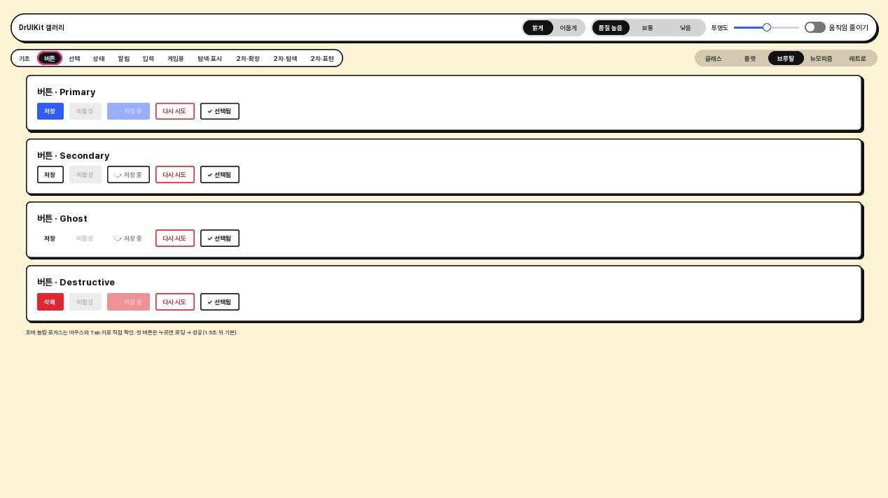
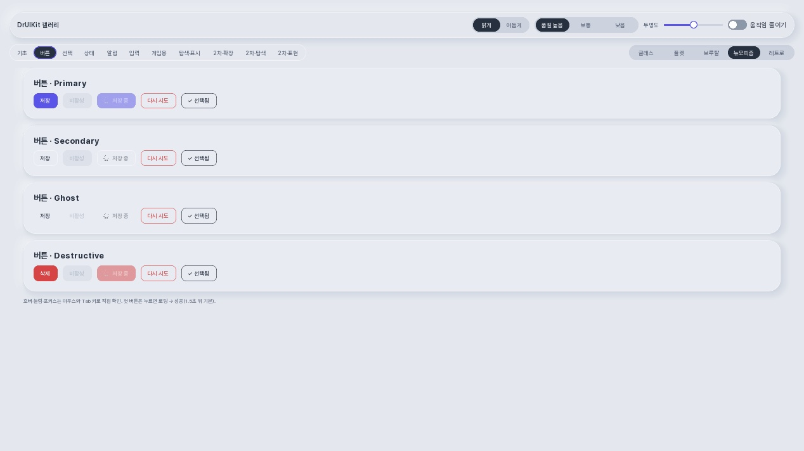
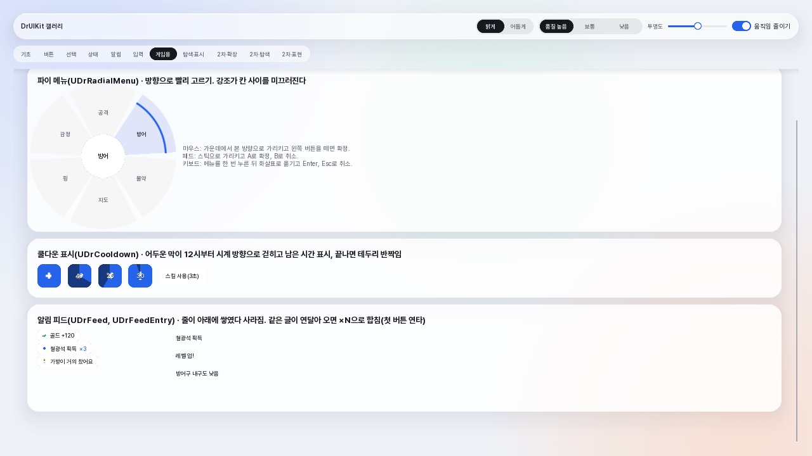
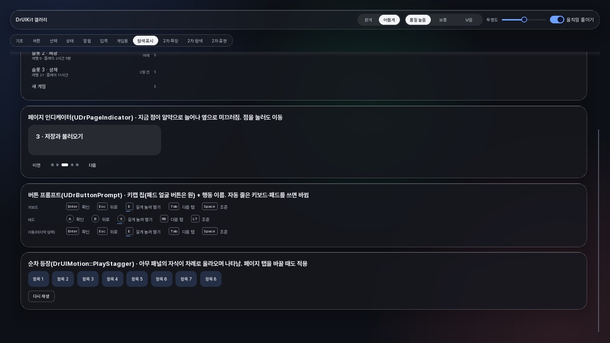
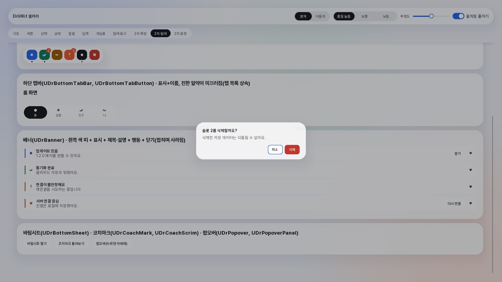
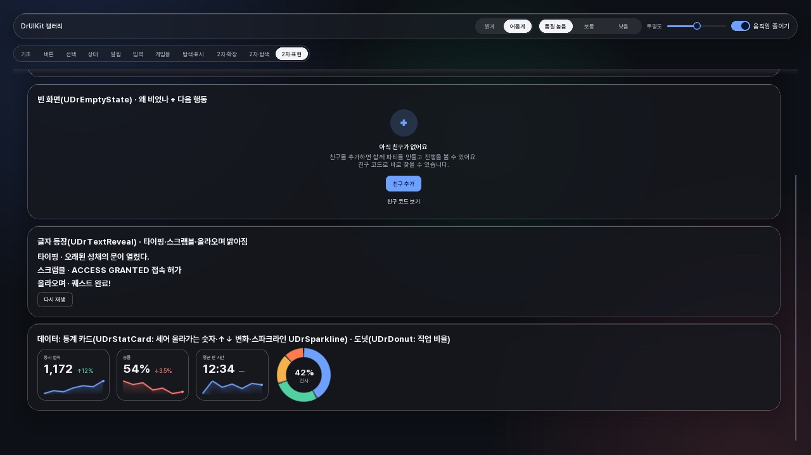

# DrUIKit

**English** | [한국어](README.ko.md)

A **style-neutral UI component** plugin for Unreal Engine 5.8. Components extend engine and CommonUI widgets by inheritance, and anything inheritance can't cover is composed inside a UserWidget. Components paint only through theme tokens; the actual look comes from a style (`UISample/<Style>`): a plugin holding a `tokens.json` that the core loads at startup. Five styles ship as samples: glass, flat, neo-brutalism, neumorphism and retro terminal.

> Status: 0.1.0 (first- and second-wave components, UI flow and screen layers). Plan and progress: `Docs/PLAN.md` (Korean).



## Layout

| Path | Role |
| --- | --- |
| `unreal/DrUIKit` | Core plugin (module `DrUIKit`, depends on UMG and CommonUI) |
| `Host/DrUIKitHost.uproject` | Standalone build and test host (no code module) |
| `UISample/Glass` | Liquid-glass style (plugin `DrUIGlass`: tokens, Pretendard font, backdrop, gallery level `L_DrUIGallery`) |
| `UISample/Flat`, `Brutal`, `Neu`, `Retro` | Flat/material, neo-brutalism, neumorphism and retro terminal styles (plugins `DrUIFlat`, `DrUIBrutal`, `DrUINeu`, `DrUIRetro`: tokens only, no code) |
| `Tools/verify.ps1` | Builds the host and runs `Automation RunTests DrUIKit+DrUIGlass` |

## What's included

Naming: components are `UDr<Component>` (`UDrButton`); supporting systems that aren't components are `UDrUI<…>` (`UDrUITheme`).

| Area | Classes |
| --- | --- |
| Theme | `UDrUITheme` (token data asset, grayscale default theme), `UDrUIThemeSubsystem` (current theme, switching, surface quality, surface transparency, reduce motion), `DrUIStyle` (style loader: finds style plugins, reads `tokens.json` and `style.json`), `UDrUIKitSettings` |
| State and motion | `EDrUIState` / `DrUIState::Resolve` (9 states with priority), `DrUIMotion` (ease-in/out cubic-bezier, staggered entrance `PlayStagger`), `FDrUISpring` |
| Basics | `UDrText` (UCommonTextBlock), `UDrIcon` (UImage), `UDrGlyph` (vector marks: check, dot, plus, close, arrows, exclamation), `UDrSurface` (UBorder + backdrop blur; transparent when the fill token is empty; multi-layer or hard-offset shadow and top highlight via `SetElevation`; border width follows the theme) |
| Buttons | `UDrButtonBase` (shared state framework, abstract), `UDrButton` (9 states, 4 variants) |
| Selection | `UDrToggleBase` (on/off base, abstract), `UDrCheckBox`, `UDrRadio` (single choice with `UCommonButtonGroupBase`), `UDrSwitch` (spring thumb), `UDrTabList` / `UDrTabButton` (UCommonTabListWidgetBase with a sliding pill or underline indicator), `UDrSegmentedControl`, `UDrSlider` (USlider + filled track, ticks, value bubble) |
| Status | `UDrBadge` (count, 99+, dot; 6 colors), `UDrProgressBar` (rounded, animated fill, indeterminate), `UDrProgressRing` (spring, indeterminate spin), `UDrSkeleton` (loading placeholder), `UDrSpinner` (UCircularThrobber, token color) |
| Notices | `UDrNoticeBase` (transient base, abstract), `UDrToast` (glass pill, 4 tones), `UDrToastStack` (stacking, oldest leaves first), `UDrSnackbar` (dark pill + action, one at a time with a queue, pauses on hover) |
| Input | `UDrTextField` (UEditableText + label, hint, character count, error), `UDrDropdown` / `UDrDropdownMenu` / `UDrDropdownItem` (UMenuAnchor list, focuses the chosen item first), `UDrHorizontalSelector` (◀ value ▶, gamepad left/right, wrap or clamp) |
| Gamepad | `DrUIInput` (Accept/Back from the engine's navigation config, Xbox/PlayStation/Nintendo button names, modal layer, focus memory, global handler for right-stick scrolling, LB/RB and LT/RT tab paging, button shortcuts, any-key listeners), `UDrKeyGlyph` (button shapes drawn without assets: face buttons incl. ✕○□△, bumpers, triggers, sticks, D-pad, View/Menu, keycaps, mouse), `UDrActionBar` (status line + the focused control's actions + screen-wide hints), `UDrPressAnyKey`, `UDrItemSlot` / `UDrItemGrid` (inventory grid: rarity, equipped, NEW, count; row wrap), `UDrStatCompare` (▲▼ vs. equipped), `DrUIFeedback` (UI sounds and short rumble) |
| Game | `UDrHoldButton` (hold to confirm with filling and rewinding), `UDrRadialMenu` (pie menu for mouse direction, gamepad stick and keyboard; spring highlight), `UDrCooldown` (clockwise veil, remaining time, flash on ready), `UDrFeed` / `UDrFeedEntry` (pickup log, merges repeats as ×N) |
| UI flow | `UDrUIFlowSubsystem` (local player subsystem: creates screen layers; title, HUD, pause, settings, back, input mode, confirm dialogs, notices), `UDrUIRootLayout` (game, menu, modal and notice layers), `UDrUIMenuWidget` / `UDrUIHUDWidget` (menu and HUD bases), `UDrConfirmDialog` (modal confirm). Configured under "Flow" and "Input" in `UDrUIKitSettings` |
| Extended | `UDrScrollBox` (thin bar, edge shading), `UDrCountUp`, `UDrAnimatedSwitcher` (fade, slide, zoom; instant under reduce motion), `UDrExpandableArea` / `UDrExpanderHeader` (spring height), `UDrTextArea`, `UDrMorphButton` (shrinks to a circle while loading, expands after a check), `UDrQuantityStepper` / `UDrIconButton` (− value +, accelerating repeat on hold), `UDrChip` (filter, choice and input chips) |
| Navigation | `UDrSidebar` / `UDrSidebarItem` (rail ↔ expanded, glass lens), `UDrDock` / `UDrDockItem` (magnify on hover), `UDrBottomTabBar` / `UDrBottomTabButton`, `UDrBanner` (inline notice), `UDrBottomSheet` (drag to dismiss), `UDrCoachMark` / `UDrCoachScrim` (spotlight + step bubble), `UDrPopover` / `UDrPopoverPanel` |
| Expression | `UDrStepIndicator`, `UDrCompletion` (drawn check), `UDrEmptyState` (reason + next action), `UDrTextReveal` (typing, scramble, rise), `UDrSparkline` / `UDrDonut` / `UDrStatCard` (data display) |
| Discovery | `UDrTooltip` (glass bubble in the engine tooltip window, title + body, `Attach`), `UDrListRow` (hover lens, selection, focus; works in button groups or as a UCommonListView entry, which needs a Widget Blueprint subclass in the editor), `UDrListItem`, `UDrPageIndicator` (current dot stretches into a pill), `UDrButtonPrompt` (keycap chip + action, switches between keyboard and gamepad, hold progress) |

## Gamepad

Every component can be driven with a gamepad or keyboard alone.

- Focus rings appear for gamepad/keyboard focus only; a mouse click doesn't leave a ring. Overlays (dialogs, popovers, sheets, dropdowns, coach marks) remember where they were opened from and give focus back when closed, and menus return to the last focused item.
- Accept and Back follow the engine's navigation config, so platforms that swap them are handled. Sliders adjust with the D-pad without locking first; scroll boxes follow focus and scroll with the right stick. Tab lists page with LB/RB (sub-tabs with LT/RT), show those buttons at both ends, and Down from a tab enters its content.
- **Inline button prompts.** Give a button `SetShortcut(KeyboardKey, GamepadKey)` and the key shape appears inside it. The key presses it from anywhere on the screen; when an overlay is open, only buttons inside that overlay respond.
- **Key shapes.** Button prompts and the action bar draw real key shapes for Xbox, PlayStation or Nintendo pads. Auto mode follows the connected pad; `Both` shows the pad and keyboard keys side by side.
- **Accessibility and feedback.** Text size scale (`SetTextScale`), UI sounds (set in project settings) and short rumble, each of which can be switched off.

**Console game menu sample** (`UDrGlassConsoleMenu`, opened from the gallery's Gamepad page or with View/M) shows a typical pad menu layout:

- Main tabs (LB/RB) and sub-tabs (LT/RT) along the top.
- Three columns: a first-level list, a second-level list and a details panel with a stat comparison.
- A status bar along the bottom with the available actions.
- In the second-level list A equips and X drops; B steps back one level, then closes.

| Console game menu | Gamepad page (PlayStation glyphs) |
| --- | --- |
|  |  |

## Styles

A style is any enabled plugin with `Tokens/tokens.json` (design tokens, light and dark) and `Tokens/style.json` (id, name, fonts, which fills follow the transparency setting, base border width). The core loads every style at startup; theme ids are `<style>-light` and `<style>-dark`. Fonts are TTF paths: `{plugin}`, `{plugin:Name}` or `{engine}`, plus an optional `hangul` typeface for Korean glyphs. To ship a style in a packaged game, stage its `Tokens/` (and fonts) with `RuntimeDependencies`, as `DrUIGlass` does.

| Flat (light) | Neo-brutalism (light) |
| --- | --- |
|  |  |
| Neumorphism (light) | Retro terminal (dark) |
|  |  |

## Gallery

Open `L_DrUIGallery` from `UISample/Glass` (the host's default map) to see every component on tabbed pages; the switch next to the tabs changes the style. When you add a component, add it to a gallery page and to `UDrGlassGallery::CoveredClasses()` in the same change; otherwise `DrUIGlass.Gallery.CoversAllKitWidgets` fails. Running with `-game -DrUIGalleryCapture -RenderOffscreen` captures every style × light/dark × page into `Saved/Screenshots` and exits (`-DrUIGalleryStyles=glass,flat` limits the styles). `-DrUIGamepadTour` instead feeds synthetic gamepad input through the Gamepad page and the console game menu and captures each step (`DrUITour_*.png`).

| Selection (dark) | Game (pie menu, cooldown, feed) |
| --- | --- |
|  |  |
| Discovery (page dots, button prompts) | Confirm dialog (modal layer) |
|  |  |
| Expression (empty state, text reveal, data) | |
|  | |

The sample's labels are in Korean; the components themselves take any text.

## Verify

```powershell
.\Tools\verify.ps1      # default engine path: C:\Program Files\Epic Games\UE_5.8
```

## License

MIT
