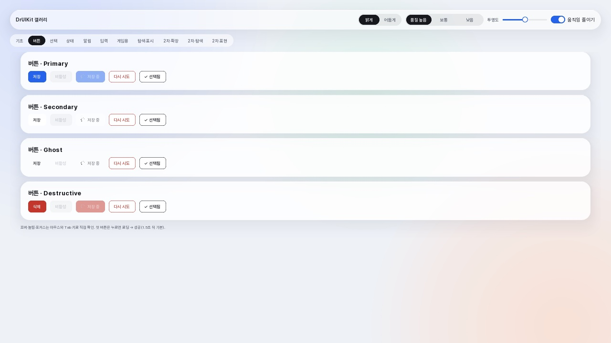
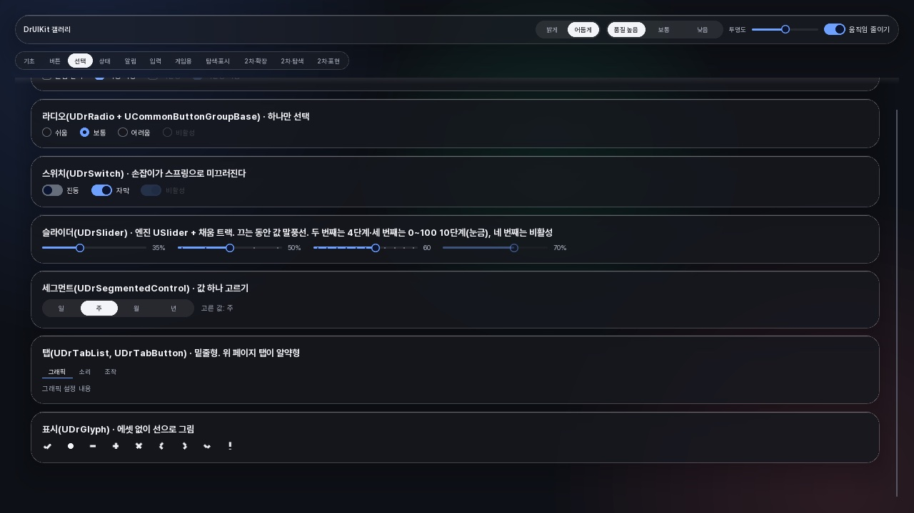
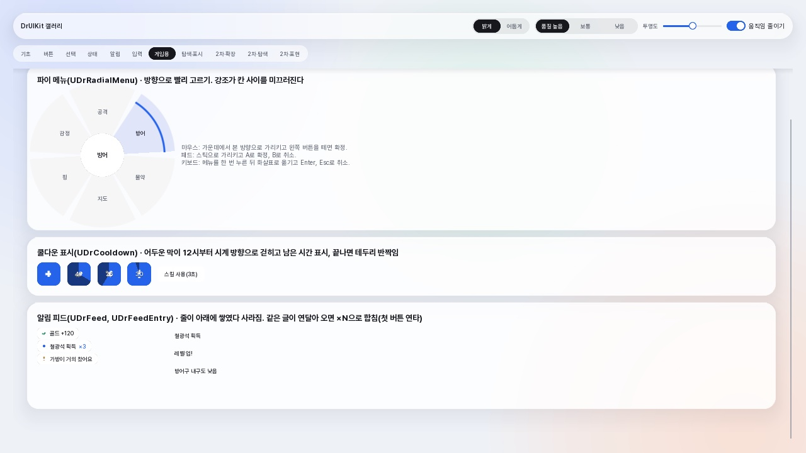
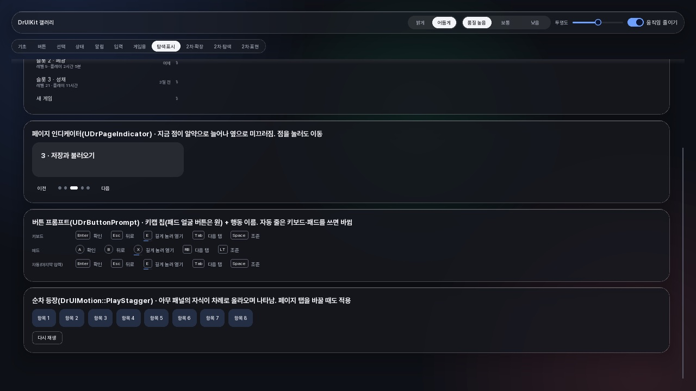
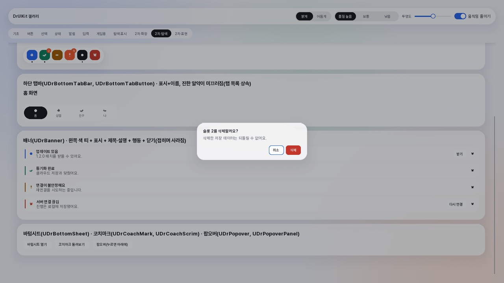
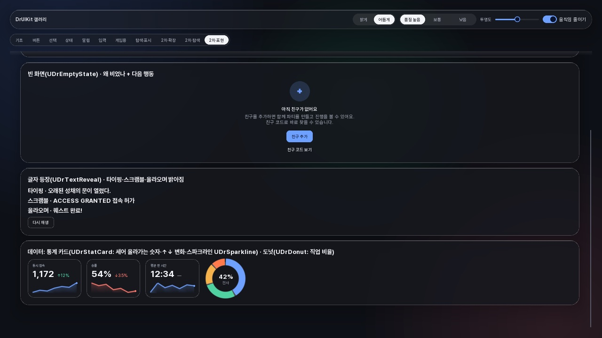

# DrUIKit

**English** | [한국어](README.ko.md)

A **style-neutral UI component** plugin for Unreal Engine 5.8. Components extend engine and CommonUI widgets by inheritance, and anything inheritance can't cover is composed inside a UserWidget. Components paint only through theme tokens; the actual look comes from a style sample (`UISample/<Style>`).

> Status: 0.1.0 (first- and second-wave components, UI flow and screen layers). Plan and progress: `Docs/PLAN.md` (Korean).



## Layout

| Path | Role |
| --- | --- |
| `unreal/DrUIKit` | Core plugin (module `DrUIKit`, depends on UMG and CommonUI) |
| `Host/DrUIKitHost.uproject` | Standalone build and test host (no code module) |
| `UISample/Glass` | Liquid-glass style sample (plugin `DrUIGlass`: tokens.json theme, Pretendard font, backdrop, gallery level `L_DrUIGallery`) |
| `Tools/verify.ps1` | Builds the host and runs `Automation RunTests DrUIKit+DrUIGlass` |

## What's included

Naming: components are `UDr<Component>` (`UDrButton`); supporting systems that aren't components are `UDrUI<…>` (`UDrUITheme`).

| Area | Classes |
| --- | --- |
| Theme | `UDrUITheme` (token data asset, grayscale default theme), `UDrUIThemeSubsystem` (current theme, switching, surface quality, surface transparency, reduce motion), `UDrUIKitSettings` |
| State and motion | `EDrUIState` / `DrUIState::Resolve` (9 states with priority), `DrUIMotion` (ease-in/out cubic-bezier, staggered entrance `PlayStagger`), `FDrUISpring` |
| Basics | `UDrText` (UCommonTextBlock), `UDrIcon` (UImage), `UDrGlyph` (vector marks: check, dot, plus, close, arrows, exclamation), `UDrSurface` (UBorder + backdrop blur; transparent when the fill token is empty; shadow and top highlight via `SetElevation`) |
| Buttons | `UDrButtonBase` (shared state framework, abstract), `UDrButton` (9 states, 4 variants) |
| Selection | `UDrToggleBase` (on/off base, abstract), `UDrCheckBox`, `UDrRadio` (single choice with `UCommonButtonGroupBase`), `UDrSwitch` (spring thumb), `UDrTabList` / `UDrTabButton` (UCommonTabListWidgetBase with a sliding pill or underline indicator), `UDrSegmentedControl`, `UDrSlider` (USlider + filled track, ticks, value bubble) |
| Status | `UDrBadge` (count, 99+, dot; 6 colors), `UDrProgressBar` (rounded, animated fill, indeterminate), `UDrProgressRing` (spring, indeterminate spin), `UDrSkeleton` (loading placeholder), `UDrSpinner` (UCircularThrobber, token color) |
| Notices | `UDrNoticeBase` (transient base, abstract), `UDrToast` (glass pill, 4 tones), `UDrToastStack` (stacking, oldest leaves first), `UDrSnackbar` (dark pill + action, one at a time with a queue, pauses on hover) |
| Input | `UDrTextField` (UEditableText + label, hint, character count, error), `UDrDropdown` / `UDrDropdownMenu` / `UDrDropdownItem` (UMenuAnchor list, focuses the chosen item first), `UDrHorizontalSelector` (◀ value ▶, gamepad left/right, wrap or clamp) |
| Game | `UDrHoldButton` (hold to confirm with filling and rewinding), `UDrRadialMenu` (pie menu for mouse direction, gamepad stick and keyboard; spring highlight), `UDrCooldown` (clockwise veil, remaining time, flash on ready), `UDrFeed` / `UDrFeedEntry` (pickup log, merges repeats as ×N) |
| UI flow | `UDrUIFlowSubsystem` (local player subsystem: creates screen layers; title, HUD, pause, settings, back, input mode, confirm dialogs, notices), `UDrUIRootLayout` (game, menu, modal and notice layers), `UDrUIMenuWidget` / `UDrUIHUDWidget` (menu and HUD bases), `UDrConfirmDialog` (modal confirm). Configured under "Flow" and "Input" in `UDrUIKitSettings` |
| Extended | `UDrScrollBox` (thin bar, edge shading), `UDrCountUp`, `UDrAnimatedSwitcher` (fade, slide, zoom; instant under reduce motion), `UDrExpandableArea` / `UDrExpanderHeader` (spring height), `UDrTextArea`, `UDrMorphButton` (shrinks to a circle while loading, expands after a check), `UDrQuantityStepper` / `UDrIconButton` (− value +, accelerating repeat on hold), `UDrChip` (filter, choice and input chips) |
| Navigation | `UDrSidebar` / `UDrSidebarItem` (rail ↔ expanded, glass lens), `UDrDock` / `UDrDockItem` (magnify on hover), `UDrBottomTabBar` / `UDrBottomTabButton`, `UDrBanner` (inline notice), `UDrBottomSheet` (drag to dismiss), `UDrCoachMark` / `UDrCoachScrim` (spotlight + step bubble), `UDrPopover` / `UDrPopoverPanel` |
| Expression | `UDrStepIndicator`, `UDrCompletion` (drawn check), `UDrEmptyState` (reason + next action), `UDrTextReveal` (typing, scramble, rise), `UDrSparkline` / `UDrDonut` / `UDrStatCard` (data display) |
| Discovery | `UDrTooltip` (glass bubble in the engine tooltip window, title + body, `Attach`), `UDrListRow` (hover lens, selection, focus; works in button groups or as a UCommonListView entry, which needs a Widget Blueprint subclass in the editor), `UDrListItem`, `UDrPageIndicator` (current dot stretches into a pill), `UDrButtonPrompt` (keycap chip + action, switches between keyboard and gamepad, hold progress) |

## Gallery

Open `L_DrUIGallery` from `UISample/Glass` (the host's default map) to see every component on tabbed pages. When you add a component, add it to a gallery page and to `UDrGlassGallery::CoveredClasses()` in the same change; otherwise `DrUIGlass.Gallery.CoversAllKitWidgets` fails. Running with `-game -DrUIGalleryCapture -RenderOffscreen` captures every theme × page into `Saved/Screenshots` and exits.

| Selection (dark) | Game (pie menu, cooldown, feed) |
| --- | --- |
|  |  |
| Discovery (page dots, button prompts) | Confirm dialog (modal layer) |
|  |  |
| Expression (empty state, text reveal, data) | |
|  | |

The sample's labels are in Korean; the components themselves take any text.

## Verify

```powershell
.\Tools\verify.ps1      # default engine path: C:\Program Files\Epic Games\UE_5.8
```

## License

MIT
